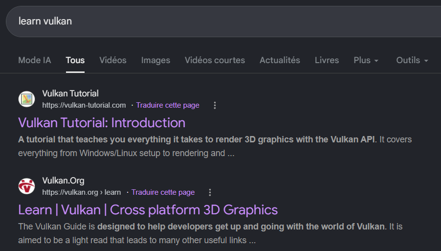

---
title: 02 Drawing a triangle
---

# TP noté

Dans ce TP, nous allons avancer étape par étape en nous appuyant sur des tutoriels existants et à jour sur Vulkan.

Nous utiliserons la dernière version de Vulkan.

Je tiens à souligner un point avant de commencer : un support de cours peut devenir obsolète, au même titre qu'un livre imprimé.

Vous pourrez tomber sur des tutoriels dont le contenu semble plus simple à suivre, voire plus fréquemment recommandé. Mais rappelez-vous une chose : la documentation officielle d'un constructeur ou d'un organisme comme Khronos regroupe un ensemble de bonnes pratiques à jour, sur lesquelles il vaut mieux se fonder.

Dans la mesure du possible, privilégiez toujours une documentation officielle et à jour.

Voici un exemple de site qui peut apparaître dans les premiers résultats de recherche, mais dont la version de Vulkan utilisée n'est pas la dernière.

Pour ce TP, nous partirons donc du tutoriel officiel de Khronos.

Le tutoriel est principalement constitué d'une documentation en ligne, accompagnée d'un support de code.

Chaque chapitre possède son propre code source afin de vous permettre de consulter le code ou d'itérer dessus.

Nous allons nous baser sur `attachments/00_base_code` et construire notre projet à partir de cette base.

Un CMake est déjà présent, ainsi qu'un script d'installation des dépendances, pour nous faciliter le travail.

???+ abstract "Pourquoi je souhaite que vous partiez d'une page blanche, quitte à faire du copier/coller ?"

    Écouter un cours, prendre des notes ou regarder une vidéo ne suffisent pas pour bien comprendre les fondamentaux.

    Vous ne vous rappellerez certainement pas des détails d'implémentation de Vulkan, mais la logique restera plus longtemps dans vos esprits si vous mettez les mains dedans.

    Nous allons donc faire l'effort de dessiner un triangle ensemble, à partir d'une simple fenêtre vide, en suivant le tutoriel officiel de Khronos.

    

    Ce diagramme ne reflète pas l'évolution des connaissances dans le temps. Pour préserver les acquis, il faut les actualiser régulièrement. Il illustre néanmoins l'acquisition de l'information à court terme.

Vous aurez le choix d'implémenter votre projet comme bon vous semble.

Ne perdez pas trop de temps en micro-optimisations ou en détails d'architecture, mais essayez de garder à l'esprit les grands principes d'un code propre, pour gagner en flexibilité et limiter les effets de bord :

- Évitez les fichiers, classes et méthodes trop volumineux.
- Découpez votre code en fonctions et en classes. Leur nommage doit refléter clairement leur responsabilité.
- Libre à vous de gérer les erreurs comme vous le souhaitez (return ou throw). Sécurisez un minimum votre code afin de garder à l'esprit les différentes stratégies de fallback de votre application.
- Créez des fichiers séparés lorsque vos classes deviennent trop volumineuses.

Nous ferons régulièrement des code reviews dans le cadre d'un contrôle continu.

Solliciter l'intervenant ne sera pas un malus. En revanche, ne pas le solliciter alors que vous êtes bloqués pourrait en être un.
